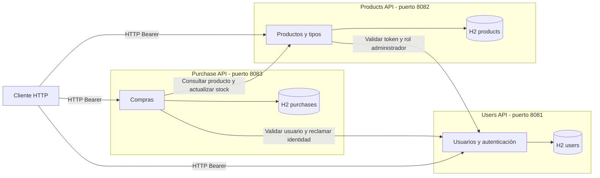

# Sopra Commerce Microservices

Monorepositorio con tres APIs REST independientes desarrolladas con Java 17 y
Spring Boot 3.4.4. El sistema separa la identidad y autenticación, el catálogo
de productos y el registro de compras, manteniendo una base de datos H2
independiente para cada microservicio.

## Índice

- [Arquitectura](#arquitectura)
- [Microservicios](#microservicios)
- [Estructura del repositorio](#estructura-del-repositorio)
- [Tecnologías](#tecnologías)
- [Requisitos](#requisitos)
- [Configuración y ejecución](#configuración-y-ejecución)
- [Autenticación JWT](#autenticación-jwt)
- [Endpoints principales](#endpoints-principales)
- [Flujo de uso completo](#flujo-de-uso-completo)
- [Documentación OpenAPI](#documentación-openapi)
- [Persistencia y datos iniciales](#persistencia-y-datos-iniciales)
- [Pruebas y compilación](#pruebas-y-compilación)
- [Manejo de errores](#manejo-de-errores)
- [Consideraciones de configuración](#consideraciones-de-configuración)

## Arquitectura



La comunicación entre microservicios se realiza mediante `WebClient` y
llamadas HTTP síncronas.

- **Users API** es la autoridad de autenticación. Emite y valida tokens JWT,
  gestiona usuarios y declara si un usuario posee el rol administrador.
- **Products API** administra el catálogo y exige un JWT válido para todos sus
  recursos. Las operaciones de escritura exigen además el permiso de
  administrador.
- **Purchase API** registra compras, identifica al usuario a través del JWT,
  consulta el producto en Products API y reduce su stock si existe disponibilidad.

No existe un API Gateway ni registro de servicios. Las direcciones entre
servicios están configuradas localmente mediante propiedades HTTP.

## Microservicios

| Servicio | Carpeta | Puerto | Responsabilidad |
| --- | --- | ---: | --- |
| Users API | `users-api-feature-jwt/` | `8081` | Registro y gestión de usuarios, autenticación JWT y autorización por rol administrador |
| Products API | `products-api-feature_jwtFromUsersMicro/` | `8082` | Gestión de tipos de producto y productos, incluido el stock |
| Purchase API | `purchase-api-feature-jwt/` | `8083` | Creación y consulta de compras; validación de usuario, producto y stock |

### Users API

Expone las rutas bajo `/auth` y `/api/users`. Utiliza JPA/Hibernate, una base
H2 en memoria y Spring Security con filtro JWT propio. Las contraseñas se
almacenan cifradas con BCrypt.

Las operaciones de gestión requieren JWT en la mayoría de las rutas. Además:

- Crear usuarios, asignar administradores y eliminar usuarios tiene controles
  por rol o por identidad.
- Un usuario puede actualizar o eliminar su propia cuenta.
- Un administrador puede crear usuarios, asignar el rol administrador,
  actualizar registros y eliminar cuentas según el filtro de identidad existente.

### Products API

Expone productos en `/api/products` y tipos de producto en
`/api/productTypes`. Cada ruta protegida recibe `Authorization: Bearer <token>`.
El filtro remoto valida el JWT contra Users API antes de procesar la solicitud.

Las operaciones `POST`, `PUT` y `DELETE` de productos y tipos de producto
requieren que el JWT contenga `isAdmin=true`. Las consultas `GET` requieren JWT
válido, pero no requieren necesariamente permisos de administrador.

### Purchase API

Expone compras en `/api/purchases`. Todas las operaciones pasan por el filtro
JWT, que valida el token contra Users API.

Al crear una compra:

1. Valida el token y obtiene el `userId`.
2. Consulta el producto solicitado en Products API.
3. Comprueba que la cantidad solicitada no supere el stock disponible.
4. Actualiza el stock mediante una operación técnica autenticada.
5. Persiste la compra con el identificador del usuario, producto y cantidad.

## Estructura del repositorio

```text
katas-sopra/
├── README.md
├── users-api-feature-jwt/
│   ├── mvnw.cmd
│   ├── pom.xml
│   └── src/main/
│       ├── java/org/example/usersapi/
│       │   ├── controller/
│       │   ├── dto/
│       │   ├── exception/
│       │   ├── filter/
│       │   ├── model/
│       │   ├── repository/
│       │   ├── security/
│       │   └── service/
│       └── resources/
│           ├── application.properties
│           └── data.sql
├── products-api-feature_jwtFromUsersMicro/
│   ├── mvnw.cmd
│   ├── pom.xml
│   └── src/main/
│       ├── java/org/example/proyectointership/
│       │   ├── client/
│       │   ├── controller/
│       │   ├── dto/
│       │   ├── exception/
│       │   ├── filter/
│       │   ├── model/
│       │   ├── repository/
│       │   ├── response/
│       │   └── service/
│       └── resources/
│           ├── application.properties
│           └── data.sql
└── purchase-api-feature-jwt/
    ├── mvnw.cmd
    ├── pom.xml
    └── src/main/
        ├── java/org/example/purchaseapi/
        │   ├── client/
        │   ├── controller/
        │   ├── dto/
        │   ├── exception/
        │   ├── filter/
        │   ├── model/
        │   ├── repository/
        │   └── service/
        └── resources/
            └── application.properties
```

Cada microservicio contiene su propio `pom.xml`, Maven Wrapper y ciclo de
vida independiente. No comparten entidades JPA ni tablas.

## Tecnologías

- Java 17
- Spring Boot 3.4.4
- Spring Web y `WebClient`
- Spring Data JPA / Hibernate
- H2 Database en memoria
- Spring Security y filtros Servlet
- JJWT 0.12
- BCrypt
- Bean Validation (`jakarta.validation`)
- Springdoc OpenAPI / Swagger UI
- Maven y Maven Wrapper
- JUnit 5 y Spring Boot Test

## Requisitos

- JDK 17 o superior
- PowerShell o terminal compatible
- Puertos locales `8081`, `8082` y `8083` disponibles
- Maven no es necesario si se usa el Maven Wrapper incluido

## Configuración y ejecución

Compila y empaqueta cada servicio por separado desde su carpeta:

```powershell
cd users-api-feature-jwt
.\mvnw.cmd clean verify

cd ..\products-api-feature_jwtFromUsersMicro
.\mvnw.cmd clean verify

cd ..\purchase-api-feature-jwt
.\mvnw.cmd clean verify
```

Para iniciar el sistema integrado, abre tres terminales y ejecuta un servicio
en cada una:

```powershell
# Terminal 1
cd users-api-feature-jwt
.\mvnw.cmd spring-boot:run
```

```powershell
# Terminal 2
cd products-api-feature_jwtFromUsersMicro
.\mvnw.cmd spring-boot:run
```

```powershell
# Terminal 3
cd purchase-api-feature-jwt
.\mvnw.cmd spring-boot:run
```

El orden recomendado es Users API, Products API y Purchase API. Si una API
dependiente se inicia antes que Users API, sus llamadas remotas podrán fallar
hasta que el servicio de usuarios esté disponible.

| Servicio | Dirección base |
| --- | --- |
| Users API | `http://localhost:8081` |
| Products API | `http://localhost:8082` |
| Purchase API | `http://localhost:8083` |

## Autenticación JWT

El login se realiza en Users API:

```http
POST /auth/login
Content-Type: application/json

{
  "email": "lluc@example.com",
  "password": "lluclluc"
}
```

La respuesta es el token JWT sin envoltorio JSON:

```text
<jwt>
```

En las solicitudes protegidas, el encabezado debe incluir el prefijo Bearer:

```http
Authorization: Bearer <jwt>
```

El token contiene las claims `email`, `userId` e `isAdmin`. Tiene una validez
configurada de aproximadamente 100 minutos. Users API valida su firma,
emisor y caducidad mediante JJWT.

La validación remota se realiza con:

```http
POST /auth/validate
Authorization: Bearer <jwt>
```

La respuesta contiene `userId`, `email` e `isAdmin`.

## Endpoints principales

### Users API

Base: `http://localhost:8081`

| Método | Ruta | Autorización | Descripción |
| --- | --- | --- | --- |
| `POST` | `/auth/register` | Pública | Registra un usuario y devuelve su perfil |
| `POST` | `/auth/login` | Pública | Valida credenciales y devuelve un JWT |
| `POST` | `/auth/validate` | Bearer | Valida el token y devuelve las claims principales |
| `GET` | `/api/users` | Bearer | Obtiene todos los usuarios |
| `GET` | `/api/users/{id}` | Bearer | Obtiene un usuario por identificador |
| `GET` | `/api/users/{id}/is-admin` | Bearer | Obtiene el estado administrador del usuario |
| `POST` | `/api/users` | Bearer, administrador | Crea un usuario |
| `PUT` | `/api/users/{id}` | Bearer, administrador o mismo usuario | Actualiza nombre y/o email |
| `PATCH` | `/api/users/{id}/admin` | Bearer, administrador | Asigna el rol administrador |
| `DELETE` | `/api/users/{id}` | Bearer, administrador o mismo usuario | Elimina el usuario |

Ejemplo de registro:

```json
{
  "name": "Ana García",
  "email": "ana@example.com",
  "password": "secreto123"
}
```

Ejemplo de actualización:

```json
{
  "name": "Ana García López",
  "email": "ana.lopez@example.com"
}
```

El usuario creado por `/auth/register` no recibe automáticamente el rol
administrador.

### Products API

Base: `http://localhost:8082`

#### Productos

| Método | Ruta | Autorización | Descripción |
| --- | --- | --- | --- |
| `GET` | `/api/products` | Bearer válido | Lista todos los productos |
| `GET` | `/api/products/{id}` | Bearer válido | Obtiene un producto |
| `POST` | `/api/products` | Bearer, administrador | Crea un producto |
| `PUT` | `/api/products/{id}` | Bearer, administrador | Actualiza el producto |
| `DELETE` | `/api/products/{id}` | Bearer, administrador | Elimina el producto |

Ejemplo de creación:

```json
{
  "name": "Orange",
  "price": 2.5,
  "stock": 12,
  "productTypeId": 1
}
```

En la actualización parcial, los campos opcionales admitidos son `name`,
`price`, `stock` y `productTypeId`:

```json
{
  "price": 2.75,
  "stock": 10
}
```

La respuesta de producto contiene `id`, `name`, `price`, `stock` y un objeto
`productType` con `id` y `name`.

#### Tipos de producto

| Método | Ruta | Autorización | Descripción |
| --- | --- | --- | --- |
| `GET` | `/api/productTypes` | Bearer válido | Lista todos los tipos |
| `GET` | `/api/productTypes/{id}` | Bearer válido | Obtiene un tipo por identificador |
| `POST` | `/api/productTypes` | Bearer, administrador | Crea un tipo |
| `PUT` | `/api/productTypes/{id}` | Bearer, administrador | Actualiza un tipo |
| `DELETE` | `/api/productTypes/{id}` | Bearer, administrador | Elimina un tipo |

Ejemplo:

```json
{
  "name": "Vegetable"
}
```

### Purchase API

Base: `http://localhost:8083`

| Método | Ruta | Autorización | Descripción |
| --- | --- | --- | --- |
| `GET` | `/api/purchases` | Bearer válido | Lista todas las compras |
| `GET` | `/api/purchases/{id}` | Bearer válido | Obtiene una compra por identificador |
| `GET` | `/api/purchases/user` | Bearer válido | Lista las compras del usuario autenticado |
| `GET` | `/api/purchases/user/product-type/{productType}` | Bearer válido | Lista compras del usuario filtradas por tipo de producto |
| `POST` | `/api/purchases` | Bearer válido | Crea una compra y reduce el stock |

Ejemplo de creación:

```json
{
  "productId": 1,
  "quantity": 2
}
```

La respuesta contiene `purchaseId`, `userId`, `productId` y `quantity`. La
API no expone ni calcula el importe total de la compra.

Si el stock disponible es menor que la cantidad solicitada, la compra no se
crea y se devuelve conflicto (`409`). También se devuelve error si el usuario
o producto no existe.

## Flujo de uso completo

Desde PowerShell se puede completar el flujo más importante:

```powershell
$loginBody = @{
    email = "lluc@example.com"
    password = "lluclluc"
} | ConvertTo-Json

$token = Invoke-RestMethod `
    -Uri "http://localhost:8081/auth/login" `
    -Method Post `
    -ContentType "application/json" `
    -Body $loginBody

$headers = @{ Authorization = "Bearer $token" }

# Consultar productos
Invoke-RestMethod `
    -Uri "http://localhost:8082/api/products" `
    -Headers $headers

# Crear una compra
$purchaseBody = @{
    productId = 1
    quantity = 1
} | ConvertTo-Json

Invoke-RestMethod `
    -Uri "http://localhost:8083/api/purchases" `
    -Method Post `
    -Headers $headers `
    -ContentType "application/json" `
    -Body $purchaseBody

# Consultar las compras del usuario autenticado
Invoke-RestMethod `
    -Uri "http://localhost:8083/api/purchases/user" `
    -Headers $headers
```

El usuario inicial `lluc@example.com` es administrador. Esta cuenta permite
ejecutar operaciones de escritura en Products API y gestión administrativa en
Users API.

## Documentación OpenAPI

Users API, Products API y Purchase API incluyen Springdoc y Swagger UI.
Mientras los servicios estén ejecutándose:

| Servicio | Swagger UI | Documentación OpenAPI |
| --- | --- | --- |
| Users API | `http://localhost:8081/swagger-ui/index.html` | `http://localhost:8081/v3/api-docs` |
| Products API | `http://localhost:8082/swagger-ui/index.html` | `http://localhost:8082/v3/api-docs` |
| Purchase API | `http://localhost:8083/swagger-ui/index.html` | `http://localhost:8083/v3/api-docs` |

## Persistencia y datos iniciales

Las tres bases de datos son independientes y se almacenan en memoria H2:

```text
jdbc:h2:mem:testdb
```

Los datos se pierden al reiniciar cada aplicación. Users API ofrece la consola
H2 en `http://localhost:8081/h2-console`.

Users API inicializa:

- `lluc@example.com`, usuario administrador.
- `bob@example.com`, usuario normal.

Products API inicializa dos tipos de producto:

- Fruit
- Berry

Y cinco productos: Apple, Kiwi, Strawberry, Raspberry y Banana, con su stock
y precio inicial correspondientes.

Purchase API comienza sin compras y las crea a partir de las solicitudes.

## Pruebas y compilación

Cada proyecto contiene pruebas unitarias o de integración bajo
`src/test`. Ejecuta el ciclo completo de Maven desde la raíz de un servicio:

```powershell
.\mvnw.cmd verify
```

Para compilar sin ejecutar las pruebas:

```powershell
.\mvnw.cmd clean package -DskipTests
```

También pueden ejecutarse pruebas concretas:

```powershell
.\mvnw.cmd test
.\mvnw.cmd -Dtest=NombreDeLaClaseTest test
```

El resultado de Maven se genera en el directorio `target/` de cada proyecto.

## Manejo de errores

Los servicios ofrecen manejadores globales de excepciones y respuestas
estructuradas con un modelo de error común. Las situaciones principales son:

| Código | Situación |
| ---: | --- |
| `400` | Validación incorrecta o datos inválidos |
| `401` | JWT ausente, inválido o expirado |
| `403` | Operación denegada por falta de permisos |
| `404` | Usuario, producto, tipo de producto o compra no encontrado |
| `409` | Stock insuficiente para la compra |
| `500` | Error interno o fallo inesperado |

Bean Validation impide en la entrada, entre otros casos, contraseñas cortas,
emails inválidos, precios negativos, stock negativo en actualizaciones y
cantidades no positivas. Los DTO de producto, tipo y compra validan los
identificadores y campos numéricos que tienen restricciones declaradas.

## Consideraciones de configuración

Los valores locales están definidos en `application.properties`:

- Users API: puertos, H2, secreto JWT, subject e issuer.
- Products API: puerto y dirección base de Users API.
- Purchase API: puerto y direcciones base de Users API y Products API.

Las conexiones locales están fijadas a `localhost`; para ejecutar los
servicios en contenedores o máquinas distintas deben sustituirse por los
nombres de host o direcciones apropiados.

El proyecto contiene valores de demostración y credenciales técnicas destinadas
al entorno local. En cualquier despliegue distinto deben externalizarse mediante
variables de entorno o un gestor de secretos. Las claves JWT, credenciales H2,
contraseñas técnicas y usuarios iniciales no deben utilizarse como credenciales
de producción.
